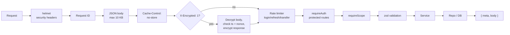
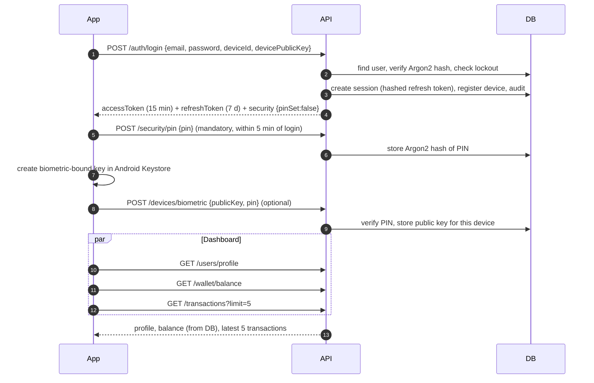
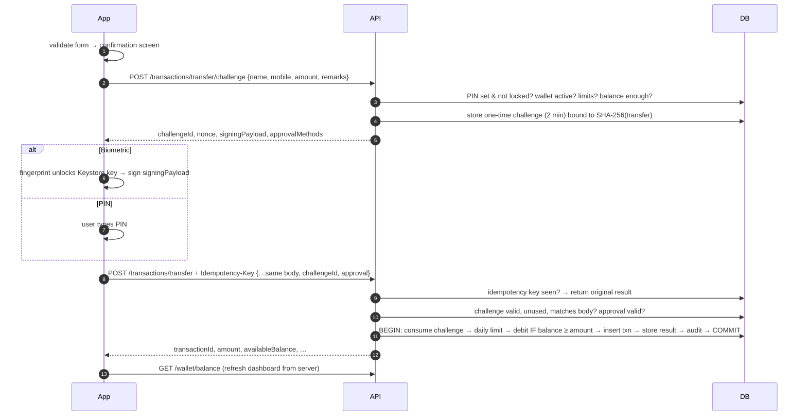
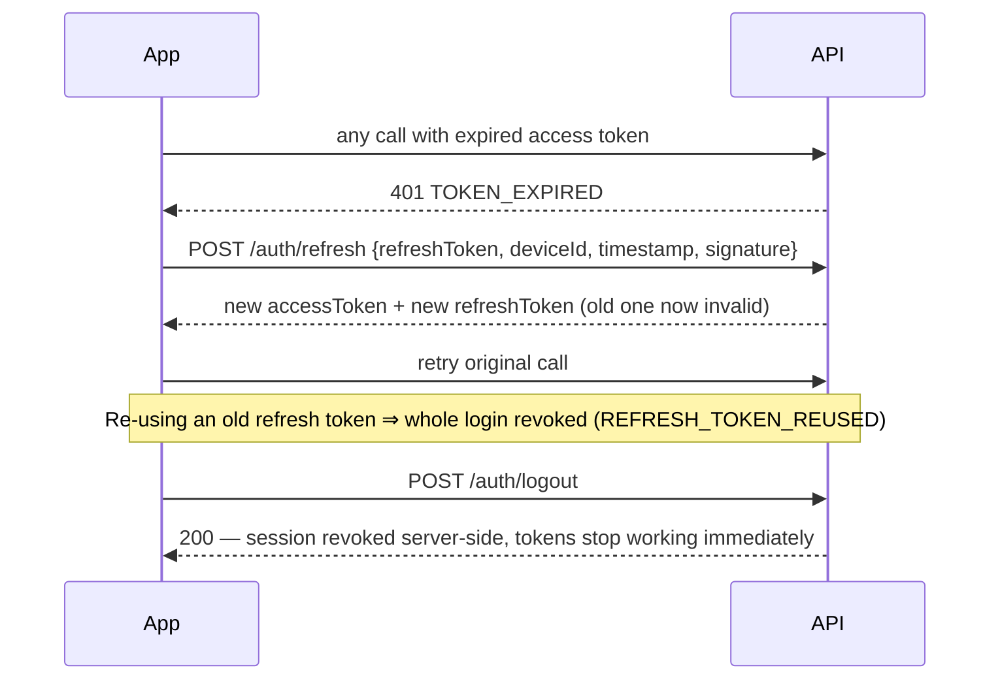

# jWallet Lite — Backend API

Mock REST API for the **jWallet Lite** Flutter digital-wallet app (jStack Flutter Developer assignment).
It handles login and sessions, wallet balance, transaction history and money transfers. Because the
domain is finance, it was built with production-style security: rotating tokens, server-verified PIN,
biometric transaction signing, idempotent atomic transfers and optional end-to-end payload encryption.

| | |
|---|---|
| **Runtime** | Node.js 24 (runs TypeScript directly via type stripping, no build step) |
| **Framework** | Express 5 |
| **Database** | libSQL — a local SQLite file in development, [Turso](https://turso.tech) when hosted |
| **Validation** | zod |
| **Auth** | JWT (HS256, `jose`) + rotating refresh tokens |
| **Hashing** | Argon2id (passwords, PINs), SHA-256 (tokens) |
| **Crypto** | Node `crypto`: ECDH P-256, HKDF-SHA256, AES-256-GCM, ECDSA P-256 |
| **Security middleware** | helmet, express-rate-limit |
| **Tests** | Node test runner + supertest (221 tests), Postman collection (Newman) |

---

## Table of contents

1. [Quick start](#1-quick-start)
2. [Project structure](#2-project-structure)
3. [Architecture and request lifecycle](#3-architecture-and-request-lifecycle)
4. [End-to-end app flow](#4-end-to-end-app-flow)
5. [Response format and error codes](#5-response-format-and-error-codes)
6. [API reference](#6-api-reference)
7. [End-to-end encryption protocol](#7-end-to-end-encryption-protocol)
8. [Database schema](#8-database-schema)
9. [Configuration](#9-configuration)
10. [Scripts](#10-scripts)
11. [Testing](#11-testing)
12. [Security summary](#12-security-summary)
13. [Known limitations](#13-known-limitations)

---

## 1. Quick start

### Prerequisites
- **Node.js 22.18+ or 24+** (`node -v`)
- npm 10+
- No database server needed — a local SQLite file is created automatically.

### Run locally
```bash
git clone <this-repo-url> j_wallet_backend
cd j_wallet_backend
npm install
npm run dev
```
On first start the server creates the schema in `data/wallet.db` and seeds demo data. It listens on
**http://localhost:3000**.

```bash
curl http://localhost:3000/health
# {"meta":{"statusCode":200,"message":"OK"},"body":{"status":"up"}}
```

### Demo credentials
| Email | Password | Wallet |
|---|---|---|
| `demo@jstack.co` | `Demo@123` | WALLET10001 · ₹25,450.75 · XXXX XXXX 4589 · 12 sample transactions |

Add more users at any time (password is hashed, wallet created):
```bash
npm run user:create -- --name "Rahul Sharma" --email rahul@example.com --password "Rahul@1234" --balance 10000.50
```

### Connecting from the Flutter app
| Where the app runs | Base URL |
|---|---|
| Android emulator | `http://10.0.2.2:3000` |
| Physical device (same Wi-Fi) | `http://<your-PC-LAN-IP>:3000` |
| Hosted | `https://<your-render-service>.onrender.com` |

### Try it with Postman
Import `postman/jWallet.postman_collection.json` and `postman/jWallet-Local.postman_environment.json`,
then run the collection top to bottom (or **Auth → Login** first, then any request).

---

## 2. Project structure

```
j_wallet_backend/
├── config/
│   ├── .env.development          # local settings (dev-only secrets, committed)
│   ├── .env.test                 # test settings (test-only secrets, committed)
│   └── .env.production           # real secrets — git-ignored, use host env vars instead
├── postman/                      # Postman collection + local environment
├── scripts/
│   └── turso-init.sql            # full schema to paste into a new Turso database (optional)
├── src/
│   ├── main.ts                   # entry: migrate → seed (optional) → maintenance → listen
│   ├── server.ts                 # Express app: global middleware, routers, error handler
│   ├── common/
│   │   ├── classes/route-errors.ts      # RouteError + typed 400/401/403/404/429 errors
│   │   ├── constants/env.constants.ts   # env schema (zod) — fails fast on bad config
│   │   ├── constants/Paths/             # every route path in one place
│   │   └── utils/
│   │       ├── response.utils.ts        # { meta, body } envelope helpers
│   │       ├── crypto.utils.ts          # SHA-256, tokens, field encryption, ECDSA verify
│   │       ├── e2e.utils.ts             # end-to-end encryption primitives
│   │       ├── e2e-client.ts            # reference client (used by tests and demo; mirrors Flutter)
│   │       ├── money.utils.ts           # paise ↔ rupees, masking, TXN reference generator
│   │       └── date.utils.ts            # IST day boundaries
│   ├── middleware/
│   │   ├── e2e-encryption.ts     # decrypt request / encrypt response (optional)
│   │   ├── auth.ts               # requireAuth (token + session + device + account), requireScope
│   │   ├── validate.ts           # zod validation of body / query / params
│   │   └── rate-limiters.ts      # per-IP limits for login, refresh, transfer
│   ├── routers/                  # HTTP layer only: validate → call service → send envelope
│   │   ├── api.router.ts
│   │   ├── auth.router.ts        # /auth/login, /auth/refresh, /auth/logout
│   │   ├── user.router.ts        # /users/profile
│   │   ├── wallet.router.ts      # /wallet/balance
│   │   ├── transaction.router.ts # /transactions, /transactions/:id, transfer challenge + transfer
│   │   ├── security.router.ts    # /security/encryption-key, /security/pin
│   │   └── device.router.ts      # /devices/biometric
│   ├── entities/                 # zod request schemas + domain helpers per feature
│   │   ├── Auth/ Security/ Transaction/ Transfer/
│   ├── services/                 # business rules (no HTTP, no SQL)
│   │   ├── AuthService.ts  TokenService.ts  PinService.ts  DeviceService.ts
│   │   ├── UserService.ts  WalletService.ts TransactionService.ts  TransferService.ts
│   ├── repos/                    # SQL only (parameterised queries)
│   │   ├── UserRepo  WalletRepo  SessionRepo  DeviceRepo  PinRepo
│   │   ├── TransactionRepo  TransferRepo  AuditRepo
│   ├── db/
│   │   ├── client.ts             # libSQL client + withWriteTransaction (retry on SQLITE_BUSY)
│   │   ├── migrations/001_init.sql
│   │   ├── migrate.ts            # applies pending migrations (runs on startup)
│   │   ├── seed.ts               # demo user/wallet + sample history
│   │   ├── maintenance.ts        # purges expired nonces/challenges/idempotency records
│   │   ├── create-user.ts        # CLI: add a user with wallet
│   │   └── cli.ts                # CLI: migrate | seed | setup
│   └── scripts/encrypted-demo.ts # shows encrypted traffic against a running server
└── tests/                        # 221 API tests (one fresh test DB per file)
```

**Layering rule:** `router → service → repo`. Routers never contain business logic, services never
write SQL or touch `req`/`res`, repos never make decisions. Every user-scoped query takes the user id
from the verified token, never from the request.

---

## 3. Architecture and request lifecycle

Every request to `/api/v1/*` passes through the same pipeline:



| Step | What it guarantees |
|---|---|
| `helmet` | HSTS, no MIME sniffing, frame denial, no `X-Powered-By` |
| Request ID | `X-Request-Id` on every response, stored in the audit log |
| `Cache-Control: no-store` | balances and tokens are never cached by devices or proxies |
| E2E encryption | optional; body unreadable even if TLS is intercepted (section 7) |
| Rate limiting | per-IP: login 10 / 15 min, refresh 30 / 15 min, transfer 20 / min |
| `requireAuth` | JWT valid (sig, alg, iss, aud, exp) **and** session not revoked **and** device matches **and** account active |
| `requireScope` | token carries the permission for this action |
| zod | strict schemas: unknown fields rejected, values normalised |
| Error handler | every error becomes the same envelope; no stack traces or SQL leak |

**Deny by default:** only `/health`, `/auth/login`, `/auth/refresh` and `/security/encryption-key` are
public. Every other route sits behind `requireAuth`.

---

## 4. End-to-end app flow

### 4.1 First login → PIN → biometric → dashboard


### 4.2 Money transfer


### 4.3 Session lifecycle


---

## 5. Response format and error codes

### Envelope
**Every** response — success or error, encrypted or not — has the same shape:
```json
{
  "meta": { "statusCode": 200, "message": "Human-readable message" },
  "body": { }
}
```
Errors put a stable machine-readable `errorCode` (and `details` for validation errors) in `body`:
```json
{
  "meta": { "statusCode": 400, "message": "Invalid request data" },
  "body": {
    "errorCode": "VALIDATION_ERROR",
    "details": [{ "field": "mobileNumber", "message": "Enter a valid 10-digit mobile number" }]
  }
}
```

### HTTP status codes
| Status | Meaning |
|---|---|
| 200 / 201 | Success / created |
| 400 | Invalid request data, invalid challenge, encryption errors |
| 401 | Missing/invalid/expired token, invalid credentials, revoked session |
| 403 | Not allowed: wrong PIN, missing scope, frozen wallet, daily limit, PIN not set |
| 404 | Transaction / wallet / route not found |
| 409 | Insufficient balance, idempotency key reused, challenge already used, PIN already set |
| 423 | PIN locked (3 wrong attempts → 24 h) |
| 429 | Rate limited, account temporarily locked (5 wrong passwords → 15 min) |
| 500 | Unexpected server error (details are logged, never returned) |

> A wrong PIN is **403**, not 401, so the app never mistakes it for an expired session and loops on refresh.

### Error codes
| errorCode | Status | When |
|---|---|---|
| `VALIDATION_ERROR` | 400 | Body / query / params / header failed validation (`details` lists each field) |
| `INVALID_JSON` | 400 | Malformed JSON body |
| `PAYLOAD_TOO_LARGE` | 413 | Body over 10 KB |
| `INVALID_CREDENTIALS` | 401 | Wrong email or password (same for both) |
| `ACCOUNT_TEMPORARILY_LOCKED` | 429 | Too many wrong passwords |
| `ACCOUNT_INACTIVE` | 403 | User is locked/frozen by the system |
| `AUTH_REQUIRED` | 401 | No `Authorization: Bearer …` header |
| `INVALID_TOKEN` | 401 | Token tampered, wrong signature/alg, user/session/device mismatch |
| `TOKEN_EXPIRED` | 401 | Access token expired → call `/auth/refresh` |
| `SESSION_REVOKED` | 401 | Logged out or session killed → go to login |
| `INSUFFICIENT_SCOPE` | 403 | Token lacks the permission for this route |
| `INVALID_REFRESH_TOKEN` | 401 | Unknown refresh token |
| `REFRESH_TOKEN_EXPIRED` | 401 | Refresh token older than 7 days |
| `REFRESH_TOKEN_REUSED` | 401 | Old refresh token used again → whole login revoked |
| `DEVICE_VERIFICATION_FAILED` | 401 | Refresh from another device / bad device signature |
| `RATE_LIMITED` | 429 | Per-IP rate limit hit |
| `PIN_NOT_SET` | 403 | Set a transaction PIN first |
| `PIN_ALREADY_SET` | 409 | Use change PIN instead |
| `REAUTH_REQUIRED` | 403 | First PIN must be set within 5 min of a password login |
| `INVALID_PIN` | 403 | Wrong PIN (`details` shows attempts left) |
| `PIN_LOCKED` | 423 | 3 wrong PINs → transfers blocked for 24 h |
| `DEVICE_REQUIRED` | 400 | Biometrics need a device-bound session |
| `DEVICE_REVOKED` | 403 | Device no longer active |
| `BIOMETRIC_NOT_ENROLLED` | 403 | No biometric key on this device |
| `INVALID_SIGNATURE` | 403 | Biometric signature doesn't verify |
| `WALLET_NOT_FOUND` | 404 | User has no wallet |
| `WALLET_FROZEN` | 403 | Wallet frozen — no transfers |
| `INSUFFICIENT_BALANCE` | 409 | Amount exceeds available balance |
| `DAILY_LIMIT_EXCEEDED` | 403 | Over ₹2,00,000 today (IST) |
| `INVALID_CHALLENGE` | 400 | Unknown challenge or belongs to another login |
| `CHALLENGE_EXPIRED` | 400 | Challenge older than 2 minutes |
| `CHALLENGE_USED` | 409 | Challenge already consumed |
| `CHALLENGE_MISMATCH` | 400 | Transfer body differs from what was approved |
| `IDEMPOTENCY_KEY_REUSED` | 409 | Same Idempotency-Key with a different body |
| `TRANSACTION_NOT_FOUND` | 404 | Unknown reference or someone else's transaction |
| `USER_NOT_FOUND` | 404 | User record missing |
| `ROUTE_NOT_FOUND` | 404 | Unknown URL |
| `ENCRYPTION_HEADERS_INVALID` | 400 | Missing/malformed `X-Enc-*` headers or invalid client key |
| `ENCRYPTION_KEY_UNKNOWN` | 400 | Client used an old server key id → update app |
| `REQUEST_EXPIRED` | 400 | Encrypted request timestamp outside ±2 min |
| `REPLAYED_REQUEST` | 400 | Encrypted request nonce already used |
| `DECRYPTION_FAILED` | 400 | Body tampered, wrong key, or sent to a different URL |
| `INTERNAL_ERROR` | 500 | Unexpected error |

---

## 6. API reference

Base path: **`/api/v1`**. All bodies are JSON (`Content-Type: application/json`).
Protected routes need `Authorization: Bearer <accessToken>`.

| # | Method | Path | Auth | Scope |
|---|---|---|---|---|
| 6.1 | GET | `/health` | public | — |
| 6.2 | POST | `/auth/login` | public | — |
| 6.3 | POST | `/auth/refresh` | refresh token | — |
| 6.4 | POST | `/auth/logout` | Bearer | — |
| 6.5 | GET | `/users/profile` | Bearer | `profile:read` |
| 6.6 | GET | `/wallet/balance` | Bearer | `wallet:read` |
| 6.7 | GET | `/transactions` | Bearer | `txn:read` |
| 6.8 | GET | `/transactions/:id` | Bearer | `txn:read` |
| 6.9 | POST | `/transactions/transfer/challenge` | Bearer | `txn:transfer` |
| 6.10 | POST | `/transactions/transfer` | Bearer | `txn:transfer` |
| 6.11 | GET | `/security/encryption-key` | public | — |
| 6.12 | POST | `/security/pin` | Bearer | `security:manage` |
| 6.13 | PUT | `/security/pin` | Bearer | `security:manage` |
| 6.14 | POST | `/devices/biometric` | Bearer | `security:manage` |
| 6.15 | DELETE | `/devices/biometric` | Bearer | `security:manage` |

---

### 6.1 `GET /health`
Liveness check for the host / uptime monitors.
```json
{ "meta": { "statusCode": 200, "message": "OK" }, "body": { "status": "up" } }
```

---

### 6.2 `POST /api/v1/auth/login`
Authenticate with email and password; opens a session.

**Request**
```json
{
  "email": "demo@jstack.co",
  "password": "Demo@123",
  "deviceId": "3f0c6a8e-5c1b-4f61-9d7e-2b1f0a9c4e11",
  "devicePublicKey": "MFkwEwYHKoZIzj0CAQYIKoZIzj0DAQcDQgAE…"
}
```
| Field | Rules |
|---|---|
| `email` | required, valid email, trimmed + lowercased, max 254 |
| `password` | required, 1–128 chars |
| `deviceId` | optional UUID — binds the session to a phone (the app always sends it) |
| `devicePublicKey` | optional base64 DER SPKI **P-256** key (Keystore, no biometric). Requires `deviceId` |

**Response 200**
```json
{
  "meta": { "statusCode": 200, "message": "Login successful" },
  "body": {
    "accessToken": "eyJhbGciOiJIUzI1NiIsInR5cCI6IkpXVCJ9…",
    "tokenType": "Bearer",
    "expiresIn": 900,
    "refreshToken": "rt_tYftq0sLb…",
    "refreshExpiresIn": 604800,
    "user": { "id": "USR10001", "name": "Demo User", "email": "demo@jstack.co" },
    "security": { "pinSet": false, "biometricEnrolled": false }
  }
}
```

**Errors:** 400 `VALIDATION_ERROR` · 401 `INVALID_CREDENTIALS` · 403 `ACCOUNT_INACTIVE` ·
429 `ACCOUNT_TEMPORARILY_LOCKED` / `RATE_LIMITED`

**Backend tasks**
1. Per-IP rate limit (10 per 15 min).
2. Validate and normalise the body (unknown fields rejected).
3. If the account is locked (`login_locked_until` in the future) → 429 before checking the password.
4. Verify the password with Argon2id. For an unknown email, verify against a dummy hash so the
   response time is identical (no account enumeration). Same 401 message for both cases.
5. On a wrong password, increment `failed_login_count`; at 5 failures lock for 15 minutes (429).
6. Only after the password is proven, reveal account status (403 if not `ACTIVE`).
7. In **one atomic batch**: reset failure counters, register/refresh the device (and its public key),
   create a session row (SHA-256 of a random 256-bit refresh token, new rotation family, 7-day expiry,
   IP, user agent), write the `LOGIN_OK` audit entry.
8. Sign a 15-minute JWT: `sub` user, `sid` session, `did` device, `scope`, `jti`, `iss`, `aud`.
9. Return tokens (refresh token shown once, only its hash is stored) and the PIN/biometric flags the
   app needs to decide the next screen.

---

### 6.3 `POST /api/v1/auth/refresh`
Exchange a refresh token for a new access + refresh token pair (rotation).

**Request**
```json
{
  "refreshToken": "rt_tYftq0sLb…",
  "deviceId": "3f0c6a8e-5c1b-4f61-9d7e-2b1f0a9c4e11",
  "timestamp": 1763372400000,
  "signature": "MEUCIQD…"
}
```
`deviceId`, `timestamp` (epoch ms) and `signature` are required only for device-bound sessions.
`signature` = base64 DER ECDSA-P256-SHA256 by the **device key** over:
```
JWALLET-REFRESH\n<refreshToken>\n<timestamp>
```

**Response 200**
```json
{
  "meta": { "statusCode": 200, "message": "Token refreshed" },
  "body": {
    "accessToken": "eyJ…", "tokenType": "Bearer", "expiresIn": 900,
    "refreshToken": "rt_new…", "refreshExpiresIn": 604800
  }
}
```

**Errors:** 400 `VALIDATION_ERROR` · 401 `INVALID_REFRESH_TOKEN` / `REFRESH_TOKEN_EXPIRED` /
`REFRESH_TOKEN_REUSED` / `SESSION_REVOKED` / `DEVICE_VERIFICATION_FAILED` · 403 `ACCOUNT_INACTIVE` ·
429 `RATE_LIMITED`

**Backend tasks**
1. Per-IP rate limit (30 per 15 min); validate body.
2. Look up the session by SHA-256 of the token.
3. **Reuse detection:** if that row was already rotated, the token was stolen or replayed → revoke the
   entire login family (all its tokens stop working) and return `REFRESH_TOKEN_REUSED`.
4. Reject revoked or expired sessions.
5. Device binding: same `deviceId`, device not revoked, and — if a device key is registered — a fresh
   (±5 min) valid signature, so a refresh token copied off the phone is useless.
6. Account must be `ACTIVE`.
7. In one write transaction: mark the old row `ROTATED` (conditional update; a concurrent second use
   counts as reuse), insert the new row in the same family, audit `TOKEN_REFRESH`.
8. Return the new pair. The old refresh token can never be used again.

---

### 6.4 `POST /api/v1/auth/logout`
End this session, or every session of the user.

**Request** — header `Authorization: Bearer <accessToken>`; body optional:
```json
{ "allDevices": true }
```

**Response 200**
```json
{ "meta": { "statusCode": 200, "message": "Logged out successfully" }, "body": { "allDevices": false } }
```
(`"Logged out from all devices"` when `allDevices` is true.)

**Errors:** 400 `VALIDATION_ERROR` · 401 auth errors

**Backend tasks**
1. `requireAuth` (token + live session).
2. Revoke every row of the current login family (or all the user's sessions with `allDevices`),
   including rotated rows whose access tokens haven't expired yet.
3. Audit `LOGOUT` / `LOGOUT_ALL`.
4. Effect is immediate: `requireAuth` checks the session on every request, so the access token is
   rejected (`SESSION_REVOKED`) on the very next call — not after 15 minutes.

---

### 6.5 `GET /api/v1/users/profile`
The caller's profile and security status.

**Response 200**
```json
{
  "meta": { "statusCode": 200, "message": "Profile fetched successfully" },
  "body": {
    "id": "USR10001",
    "name": "Demo User",
    "email": "demo@jstack.co",
    "initials": "DU",
    "memberSince": "2026-11-17T06:39:46.993Z",
    "security": { "pinSet": true, "biometricEnrolled": false }
  }
}
```

**Errors:** 401 / 403 auth errors · 404 `USER_NOT_FOUND`

**Backend tasks**
1. `requireAuth` + `profile:read`.
2. Load the user by the **token's** user id (query parameters like `?userId=` are ignored).
3. Compute avatar initials; report whether a PIN exists and whether **this device** has a biometric key.
4. Never returns password hash, lockout counters or internal ids.

---

### 6.6 `GET /api/v1/wallet/balance`
The authoritative wallet balance.

**Response 200**
```json
{
  "meta": { "statusCode": 200, "message": "Wallet balance fetched successfully" },
  "body": {
    "walletId": "WALLET10001",
    "currency": "INR",
    "availableBalance": 25450.75,
    "maskedAccountNumber": "XXXX XXXX 4589",
    "status": "ACTIVE",
    "updatedAt": "2026-11-17T06:39:46.993Z"
  }
}
```

**Errors:** 401 / 403 auth errors · 404 `WALLET_NOT_FOUND`

**Backend tasks**
1. `requireAuth` + `wallet:read`.
2. Read the wallet of the token's user fresh from the database (never cached; `Cache-Control: no-store`).
3. Convert integer paise to rupees exactly (2545075 → 25450.75).
4. Only the last 4 digits of the account number are stored or returned.

---

### 6.7 `GET /api/v1/transactions`
Transaction history, newest first, with search, filters and pagination.

**Query parameters** (all optional, each at most once, unknown ones rejected)
| Param | Rules | Example |
|---|---|---|
| `type` | `CREDIT` or `DEBIT` (case-insensitive) | `type=credit` |
| `status` | `SUCCESS`, `FAILED`, `PENDING` | `status=FAILED` |
| `q` | search name or reference, 1–50 chars, partial, case-insensitive | `q=rahul` |
| `from`, `to` | `YYYY-MM-DD`, India time, inclusive, `from ≤ to` | `from=2026-11-01&to=2026-11-17` |
| `page` | integer ≥ 1 (default 1) | `page=2` |
| `limit` | 1–50 (default 20); dashboard uses `limit=5` | `limit=5` |

**Response 200**
```json
{
  "meta": { "statusCode": 200, "message": "Transactions fetched successfully" },
  "body": {
    "items": [
      {
        "id": "TXN202611173VFCMA",
        "type": "DEBIT",
        "amount": 1500,
        "currency": "INR",
        "beneficiaryName": "Rahul Sharma",
        "status": "SUCCESS",
        "createdAt": "2026-11-17T05:19:27.085Z"
      }
    ],
    "pagination": { "page": 1, "limit": 20, "totalItems": 12, "totalPages": 1, "hasNextPage": false }
  }
}
```
An empty result is still `200` with `"message": "No transactions found"` and `"items": []`.

**Errors:** 400 `VALIDATION_ERROR` · 401 / 403 auth errors

**Backend tasks**
1. `requireAuth` + `txn:read`; validate the query (repeated or unknown keys → 400).
2. Build a **parameterised** query always scoped to `user_id = <token user>`.
3. Search uses `LIKE` with `%`, `_` and `\` escaped, so user input is matched literally.
4. Convert IST calendar days to UTC bounds for `from`/`to`.
5. Order by `created_at DESC, id DESC` (stable pagination); return total count and page info.

---

### 6.8 `GET /api/v1/transactions/:id`
Details of one transaction by its public reference.

**Response 200**
```json
{
  "meta": { "statusCode": 200, "message": "Transaction details fetched successfully" },
  "body": {
    "id": "TXN202611173VFCMA",
    "type": "DEBIT",
    "amount": 1500,
    "currency": "INR",
    "beneficiaryName": "Rahul Sharma",
    "status": "SUCCESS",
    "createdAt": "2026-11-17T05:19:27.085Z",
    "mobileNumber": "XXXXXX3210",
    "remarks": "Payment for services"
  }
}
```
`remarks` is `null` when there are none.

**Errors:** 400 `VALIDATION_ERROR` (malformed id) · 401 / 403 auth errors · 404 `TRANSACTION_NOT_FOUND`

**Backend tasks**
1. `requireAuth` + `txn:read`; validate the id (`[A-Za-z0-9-]{1,40}`, case-insensitive).
2. Query `WHERE reference = ? AND user_id = <token user>`.
3. Another user's transaction returns the **same 404** as a non-existent one (references can't be probed).
4. The mobile number is stored AES-256-GCM encrypted; only the masked form is returned.

---

### 6.9 `POST /api/v1/transactions/transfer/challenge`
Step 1 of a transfer: validate it and get a one-time approval challenge.

**Request**
```json
{
  "beneficiaryName": "Rahul Sharma",
  "mobileNumber": "9876543210",
  "amount": 1500.00,
  "remarks": "Payment for services"
}
```
| Field | Rules |
|---|---|
| `beneficiaryName` | required, 1–100, letters / spaces / `.` `'` `-`; extra spaces collapsed |
| `mobileNumber` | required string, Indian 10-digit `^[6-9]\d{9}$` |
| `amount` | required **number**, > 0, max 2 decimals, ≤ ₹1,00,000 per transfer |
| `remarks` | optional, ≤ 100 chars, no control characters; empty → `null` |

**Response 201**
```json
{
  "meta": { "statusCode": 201, "message": "Approve this transfer with your fingerprint or PIN" },
  "body": {
    "challengeId": "01a1e8a2-…",
    "nonce": "q1Xk…",
    "expiresAt": "2026-11-17T07:02:00.000Z",
    "approvalMethods": ["BIOMETRIC", "PIN"],
    "signingPayload": "JWALLET-TRANSFER\n01a1e8a2-…\nq1Xk…\n9f86d0…",
    "summary": {
      "beneficiaryName": "Rahul Sharma",
      "mobileNumber": "XXXXXX3210",
      "amount": 1500,
      "currency": "INR",
      "remarks": "Payment for services"
    }
  }
}
```
`BIOMETRIC` is listed only if this device has an enrolled biometric key.

**Errors:** 400 `VALIDATION_ERROR` · 403 `PIN_NOT_SET` / `WALLET_FROZEN` / `DAILY_LIMIT_EXCEEDED` ·
404 `WALLET_NOT_FOUND` · 409 `INSUFFICIENT_BALANCE` · 423 `PIN_LOCKED` · 429 `RATE_LIMITED`

**Backend tasks**
1. `requireAuth` + `txn:transfer`, rate limit, strict validation, rupees → integer paise.
2. Fail fast so the app can show the error before the confirmation screen: per-transfer max, PIN
   exists and isn't locked, wallet exists and is active, balance is enough, today's (IST) debits +
   amount ≤ ₹2,00,000.
3. Create a challenge: random 256-bit nonce, `payload_hash = SHA-256(name, mobile, paise, remarks)`,
   bound to this login, valid for 2 minutes, single use.
4. Return the exact `signingPayload` the biometric key must sign, plus a masked summary for the
   confirmation screen.

---

### 6.10 `POST /api/v1/transactions/transfer`
Step 2: move the money. Requires an approval for the challenge.

**Headers**
```
Authorization: Bearer <accessToken>
Idempotency-Key: 7c1e2a4b-9f3d-4c55-8a10-2e6f7b9d1c34     (8–64 chars: letters, digits, - or _)
Content-Type: application/json
```

**Request** — the same transfer fields as the challenge, plus:
```json
{
  "beneficiaryName": "Rahul Sharma",
  "mobileNumber": "9876543210",
  "amount": 1500.00,
  "remarks": "Payment for services",
  "challengeId": "01a1e8a2-…",
  "approval": { "method": "PIN", "pin": "2580" }
}
```
or with biometrics:
```json
"approval": { "method": "BIOMETRIC", "signature": "MEUCIQD…" }
```
`signature` = base64 DER ECDSA-P256-SHA256 of `signingPayload`, made by the biometric-bound Keystore key.

**Response 200**
```json
{
  "meta": { "statusCode": 200, "message": "Transfer successful" },
  "body": {
    "transactionId": "TXN20261117G7C2A9",
    "status": "SUCCESS",
    "amount": 1500,
    "currency": "INR",
    "availableBalance": 23950.75,
    "beneficiaryName": "Rahul Sharma",
    "mobileNumber": "XXXXXX3210",
    "remarks": "Payment for services",
    "approvalMethod": "PIN",
    "createdAt": "2026-11-17T07:00:41.512Z"
  }
}
```
A retry with the same `Idempotency-Key` and body returns this exact response again with header
`Idempotent-Replayed: true` and **no second debit**.

**Errors:** 400 `VALIDATION_ERROR` / `INVALID_CHALLENGE` / `CHALLENGE_EXPIRED` / `CHALLENGE_MISMATCH` ·
403 `INVALID_PIN` / `BIOMETRIC_NOT_ENROLLED` / `INVALID_SIGNATURE` / `WALLET_FROZEN` /
`DAILY_LIMIT_EXCEEDED` / `PIN_NOT_SET` · 409 `INSUFFICIENT_BALANCE` / `IDEMPOTENCY_KEY_REUSED` /
`CHALLENGE_USED` · 423 `PIN_LOCKED` · 429 `RATE_LIMITED`

**Backend tasks** (order matters)
1. `requireAuth` + `txn:transfer`, rate limit, validate the `Idempotency-Key` header and body.
2. **Idempotency first:** if `(user, key)` exists → same body hash: return the stored response;
   different body: 409. Checked before the challenge so a transfer whose response was lost can be
   retried safely.
3. **Challenge:** exists, belongs to this user **and** login family (survives token refresh), unused,
   not expired, and its hash equals the hash of this body — any change after approval → 400.
4. **Approval:**
   - `PIN` → Argon2 verify; wrong PIN increments an atomic server-side counter; 3 strikes lock for 24 h.
   - `BIOMETRIC` → PIN must not be locked; verify the ECDSA signature with the public key enrolled
     for **this device** over the challenge's `signingPayload`.
5. **One write transaction (all or nothing):**
   1. re-check idempotency (concurrent duplicate → replay),
   2. consume the challenge (`UPDATE … WHERE used_at IS NULL AND expires_at > now`),
   3. re-check the daily limit,
   4. debit with `UPDATE wallets SET balance = balance − amount WHERE user_id = ? AND status = 'ACTIVE'
      AND balance ≥ amount RETURNING balance` — the balance check and the debit are one statement, so
      parallel transfers can never overdraw,
   5. insert the DEBIT transaction (mobile encrypted + masked, balance after, approval method, key),
   6. store the response under the idempotency key,
   7. audit `TRANSFER_OK`.
6. Any rejection is audited as `TRANSFER_REJECTED`. The app must not change the balance itself — it
   shows `availableBalance` and re-fetches `/wallet/balance`.

---

### 6.11 `GET /api/v1/security/encryption-key`
The server's public key for end-to-end encryption (the app also bundles it).
```json
{
  "meta": { "statusCode": 200, "message": "Encryption key fetched successfully" },
  "body": {
    "kid": "prod-1",
    "alg": "ECDH-P256+HKDF-SHA256+A256GCM",
    "publicKey": "BAzscdxu/qcQ9O3a6x5txZYmXyVo6GJPO96AV7bGQ96kr45oHkw6eYBIT2cCBTyfgfliNHRBEUVBufhhHgNhxTc="
  }
}
```

---

### 6.12 `POST /api/v1/security/pin` — set the transaction PIN
Mandatory once per user (UPI-style), right after the first login.

**Request**
```json
{ "pin": "2580" }
```
4 or 6 digits. Weak PINs are rejected: one repeated digit (`0000`), straight runs (`1234`, `987654`),
repeated pairs (`1212`, `121212`).

**Response 201**
```json
{ "meta": { "statusCode": 201, "message": "Transaction PIN set" }, "body": { "pinSet": true } }
```

**Errors:** 400 `VALIDATION_ERROR` · 403 `REAUTH_REQUIRED` · 409 `PIN_ALREADY_SET`

**Backend tasks**
1. `requireAuth` + `security:manage`; validate format and strength.
2. **Fresh-auth check:** allowed only within 5 minutes of a password login, so a stolen token can't
   set a PIN.
3. Store an Argon2id hash (`INSERT … ON CONFLICT DO NOTHING` → 409 if one exists); audit `PIN_SET`.

---

### 6.13 `PUT /api/v1/security/pin` — change the PIN
**Request**
```json
{ "currentPin": "2580", "newPin": "3691" }
```
**Response 200**
```json
{ "meta": { "statusCode": 200, "message": "Transaction PIN changed" }, "body": { "pinChanged": true } }
```
**Wrong current PIN — 403**
```json
{
  "meta": { "statusCode": 403, "message": "Incorrect PIN. 2 attempts left." },
  "body": { "errorCode": "INVALID_PIN", "details": [{ "field": "pin", "message": "2 attempts left" }] }
}
```
**Errors:** 400 `VALIDATION_ERROR` (weak, same as current) · 403 `INVALID_PIN` / `PIN_NOT_SET` · 423 `PIN_LOCKED`

**Backend tasks**
1. Verify the current PIN through the shared lockout logic: the failure counter is incremented with a
   single `UPDATE … RETURNING`, so parallel guesses can't exceed the limit; 3 strikes lock for 24 h;
   the counter lives on the server (reinstalling the app doesn't reset it); a correct PIN resets it.
2. Store the new hash, reset counters, audit `PIN_CHANGED`.

---

### 6.14 `POST /api/v1/devices/biometric` — enable biometric approval
**Request**
```json
{
  "publicKey": "MFkwEwYHKoZIzj0CAQYIKoZIzj0DAQcDQgAE…",
  "pin": "2580"
}
```
`publicKey` = base64 DER SPKI P-256 key created in the Android Keystore with "user authentication
required for every use" (biometric).

**Response 200**
```json
{
  "meta": { "statusCode": 200, "message": "Biometric approval enabled" },
  "body": { "biometricEnrolled": true, "enrolledAt": "2026-11-17T06:50:12.004Z" }
}
```
**Errors:** 400 `VALIDATION_ERROR` / `DEVICE_REQUIRED` · 403 `INVALID_PIN` / `PIN_NOT_SET` / `DEVICE_REVOKED` · 423 `PIN_LOCKED`

**Backend tasks**
1. Session must be device-bound (login with `deviceId`).
2. The user proves identity with the transaction PIN (same lockout rules).
3. Validate the key is a real P-256 public key; store it for this device (re-enrolling replaces it);
   audit `BIOMETRIC_ENROLLED`.

### 6.15 `DELETE /api/v1/devices/biometric` — disable biometric approval
```json
{ "meta": { "statusCode": 200, "message": "Biometric approval disabled" }, "body": { "biometricEnrolled": false } }
```
Removes this device's biometric key; the PIN still works. Audits `BIOMETRIC_REMOVED`.

---

## 7. End-to-end encryption protocol

Optional on the server (Postman/cURL can send plain JSON); **the mobile app always encrypts**.
It protects bodies even if TLS is intercepted (user-installed CA, debugging proxy, compromised network).
The reference implementation is `src/common/utils/e2e-client.ts`.

**Per request, the client:**
1. Generates an ephemeral P-256 key pair.
2. `shared = ECDH(ephemeralPrivate, serverPublic)`.
3. `key = HKDF-SHA256(shared, salt = nonce bytes, info = "JWALLET-E2E-v1|<kid>", 32 bytes)`.
4. Encrypts the JSON body with AES-256-GCM, 12-byte random IV, and
   `AAD = "JWALLET-E2E-v1\nREQ\n<METHOD>\n<path+query>\n<ts>\n<nonce>"`.

**Request**
```
X-Encrypted: 1
X-Enc-Kid: prod-1
X-Enc-Epk: <base64 uncompressed ephemeral public point, 65 bytes>
X-Enc-Ts: <epoch ms>
X-Enc-Nonce: <base64url, 16 random bytes>

{ "payload": "<base64(iv ‖ ciphertext ‖ tag)>" }      ← omitted for GET
```

**Response** (success and errors): header `X-Encrypted: 1`, body `{ "payload": "<base64>" }`,
sealed with the same key and `AAD = "JWALLET-E2E-v1\nRES\n<nonce>\n<httpStatus>"`. Decrypted, it is
the normal `{ meta, body }` envelope.

**Server checks:** known `kid`; timestamp within ±2 minutes; valid curve point; decryption with the
AAD (a body can't be moved to another URL, method or query); nonce never seen before (stored until
it expires) — otherwise 400 with the matching error code (plain, since no key could be agreed).

Run `npm run demo:encrypted` against a running server to see the wire format vs decrypted data.

---

## 8. Database schema

Money is stored as **integer paise** (₹1 = 100). Timestamps are ISO-8601 UTC text.
Full DDL: `src/db/migrations/001_init.sql` (also `scripts/turso-init.sql`).

| Table | Purpose | Key columns / constraints |
|---|---|---|
| `users` | Accounts | `public_id` (USR10001), unique lowercase `email`, Argon2id `password_hash`, `status`, `failed_login_count`, `login_locked_until` |
| `wallets` | One per user | `public_id` (WALLET10001), `balance_paise CHECK ≥ 0`, `account_last4`, `status` |
| `transactions` | History | unique `reference` (TXN…), `type`, `amount_paise CHECK > 0`, counterparty name, **encrypted** + masked mobile, `status`, `balance_after_paise`, `approval_method`, `idempotency_key`; index `(user_id, created_at DESC)` |
| `transaction_pins` | UPI-style PIN | Argon2id `pin_hash`, `failed_count`, `locked_until` |
| `devices` | Phones per user | `device_id`, device public key, biometric public key; unique `(user_id, device_id)` |
| `sessions` | Logins | `refresh_token_hash` (SHA-256, unique), `family_id` (rotation chain), `password_auth_at`, `expires_at`, `revoked_at`, `revoke_reason` |
| `transfer_challenges` | One-time approvals | `nonce`, `payload_hash`, `expires_at`, `used_at` |
| `idempotency_keys` | Transfer replay results | PK `(user_id, key)`, `request_hash`, stored response |
| `request_nonces` | E2E replay protection | PK `nonce`, `expires_at` |
| `audit_log` | Security events | `action`, `ip`, `device_id`, `request_id`, JSON `metadata` (never secrets) |
| `schema_migrations` | Applied migrations | — |

Expired nonces, old challenges, idempotency records older than 24 h and sessions dead for 30+ days are
purged every 10 minutes.

---

## 9. Configuration

Settings live in `config/.env.<NODE_ENV>`. On a host (Render) set them as environment variables
instead; real env vars take precedence. The server validates everything on startup and refuses to
start on a bad value.

| Variable | Default | Description |
|---|---|---|
| `NODE_ENV` | — | `development`, `test` or `production` |
| `PORT` | — | HTTP port |
| `TRUST_PROXY` | `0` | Proxies in front (Render: `1`) — needed for correct client IPs |
| `DATABASE_URL` | — | `file:./data/wallet.db` or `libsql://<db>.turso.io` |
| `DATABASE_AUTH_TOKEN` | — | Turso token (empty for local files) |
| `AUTO_SEED` | `false` | Seed demo data when the database is empty |
| `JWT_SECRET` | — | ≥ 32 random characters |
| `JWT_ISSUER` / `JWT_AUDIENCE` | `jwallet-api` / `jwallet-app` | JWT claims |
| `ACCESS_TOKEN_TTL_SEC` | `900` | Access token lifetime |
| `REFRESH_TOKEN_TTL_SEC` | `604800` | Refresh token lifetime |
| `MAX_FAILED_LOGINS` / `LOGIN_LOCK_MINUTES` | `5` / `15` | Account lockout |
| `LOGIN_RATE_LIMIT_MAX` / `LOGIN_RATE_LIMIT_WINDOW_SEC` | `10` / `900` | Login rate limit per IP |
| `REFRESH_RATE_LIMIT_MAX` | `30` | Refreshes per IP per 15 min |
| `TRANSFER_RATE_LIMIT_MAX` | `20` | Transfer calls per IP per minute |
| `PIN_MAX_ATTEMPTS` / `PIN_LOCK_HOURS` | `3` / `24` | PIN lockout |
| `FRESH_AUTH_MINUTES` | `5` | Window after login to set the first PIN |
| `MAX_TRANSFER_AMOUNT` | `100000` | ₹ per transfer |
| `DAILY_TRANSFER_LIMIT` | `200000` | ₹ per IST day |
| `CHALLENGE_TTL_SEC` | `120` | Transfer challenge lifetime |
| `FIELD_ENCRYPTION_KEY` | — | base64 32 bytes, AES-256-GCM for mobile numbers. **Never change once data exists** |
| `SERVER_ENC_KEY_ID` | — | id of the E2E key (`prod-1`) |
| `SERVER_ENC_PRIVATE_KEY` | — | base64 32-byte P-256 private key for E2E |
| `ENC_MAX_SKEW_SEC` | `120` | Allowed clock difference for encrypted requests |

Generate secrets:
```bash
node -e "console.log(require('crypto').randomBytes(48).toString('base64url'))"   # JWT_SECRET
node -e "console.log(require('crypto').randomBytes(32).toString('base64'))"      # FIELD_ENCRYPTION_KEY
node -e "const c=require('crypto').createECDH('prime256v1');c.generateKeys();console.log(c.getPrivateKey('base64'), c.getPublicKey('base64'))"   # E2E private + public key
```

> `config/.env.development` and `.env.test` contain clearly marked dev/test-only secrets and are
> committed so the project runs out of the box. `config/.env.production` is git-ignored.

---

## 10. Scripts

| Command | What it does |
|---|---|
| `npm run dev` | Start on :3000 with auto-restart (local SQLite) |
| `npm start` | Start with production settings |
| `npm test` | Run all API tests on a separate test database |
| `npm run typecheck` | TypeScript type check |
| `npm run lint` / `npm run format` | ESLint / Prettier |
| `npm run db:setup` | Apply migrations + seed demo data (local) |
| `npm run db:setup:prod` | Same, against the production database |
| `npm run db:migrate` / `npm run db:seed` | Each step separately |
| `npm run user:create -- --name … --email … --password … [--balance …]` | Add a user + wallet (local) |
| `npm run user:create:prod -- …` | Same, production database |
| `npm run demo:encrypted [-- <baseUrl> <email> <password>]` | Show encrypted traffic against a running server |

---

## 11. Testing

```bash
npm test
```
**221 tests** across 7 files, each starting from a freshly reset test database (`data/test.db`):

| File | Covers |
|---|---|
| `auth.login.test.ts` | success, JWT claims, hashed storage, same 401 for unknown email, lockout, validation |
| `auth.refresh-logout.test.ts` | rotation, reuse detection, device proofs, expiry, instant logout, all-devices |
| `users-wallet.test.ts` | profile/balance, forged / `alg:none` / mixed-user tokens, scopes, frozen account, no leaks |
| `transactions.test.ts` | pagination, filters, search (SQL wildcards literal), IST dates, ownership 404s |
| `security.test.ts` | PIN rules, fresh-auth, 3-strike lock, parallel guesses, biometric enrollment |
| `transfer.test.ts` | exact paise math, idempotency (incl. 5 parallel), overdraft races, tampering, signatures, limits |
| `encryption.test.ts` | encrypted round trips, tampering, AAD binding, replay, clock skew, key id |

**Postman / Newman:** the collection in `postman/` checks the status and envelope of every request:
```bash
npx newman run postman/jWallet.postman_collection.json -e postman/jWallet-Local.postman_environment.json
```

---

## 12. Security summary

| Threat | Mitigation |
|---|---|
| Password guessing | Argon2id, per-IP rate limit, per-account lockout, identical response/timing for unknown emails |
| Stolen access token | 15-minute lifetime, checked against a live session on every request, instant logout |
| Stolen refresh token | One-time use with rotation; reuse revokes the whole login; device-key proof for device-bound sessions |
| Reading other users' data | User id only from the verified token; every query scoped by user; 404 (not 403) for others' records |
| Tampered / forged JWT | Fixed algorithm (HS256), issuer + audience checks, `alg:none` and foreign keys rejected |
| Unauthorised transfer | Two-step challenge + biometric signature (Keystore) or server-verified PIN with 24 h lockout |
| Changing a transfer after approval | Challenge bound to SHA-256 of the exact transfer; any difference → rejected |
| Double debit / double tap / retries | Idempotency-Key with stored result; one-time challenge |
| Overdraft under concurrency | Balance check and debit in one conditional `UPDATE`, inside a transaction; `CHECK (balance ≥ 0)` |
| Floating-point money errors | Integer paise everywhere; amounts with > 2 decimals rejected |
| Traffic interception | HTTPS + optional E2E encryption (ECDH + AES-GCM) with replay protection |
| Injection | Parameterised SQL only; strict zod schemas; `LIKE` wildcards escaped |
| Data leaks | No stack traces; secrets never logged; mobile numbers encrypted at rest; masked in responses |
| Abuse | Rate limits, 10 KB body limit, `Cache-Control: no-store`, helmet headers, audit log |

---

## 13. Known limitations

- **Mock payments:** transfers send to a mobile number; no receiving wallet is credited and no real
  payment network is involved (as the assignment specifies).
- **Single-instance rate limiting:** limits are kept in memory. Running several server instances would
  need a shared store (e.g. Redis).
- **Free hosting cold start:** on Render's free tier the server sleeps after inactivity; the first
  request can take 30–60 s.
- **Key rotation:** one active E2E key (`kid`) at a time; rotating requires an app update.
- **No admin API:** users are created with the `user:create` script; accounts are frozen/unfrozen in
  the database.
